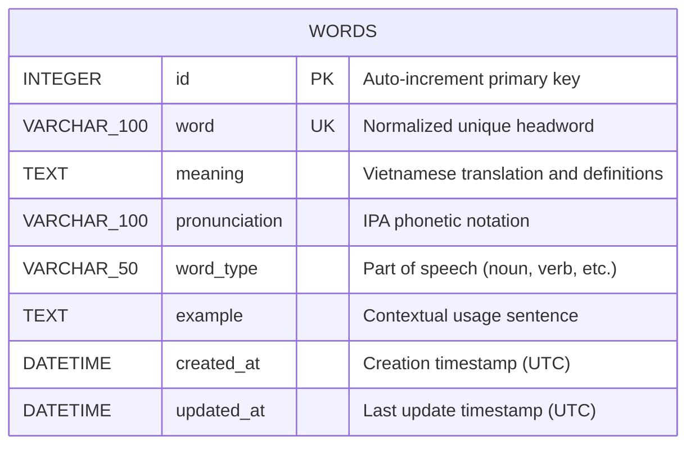

# Database Design Specification

## 1. Relational Database Engine & Configuration
- **Engine**: SQLite 3 (via SQLAlchemy 2.x)
- **Database File**: `backend/smart_dictionary.db`
- **Role**: Persistent **Source of Truth** for all dictionary entries.
- **Connection Configuration**: Thread safety enabled with `check_same_thread=False` and connection pooling managed via SQLAlchemy `SessionLocal`.

---

## 2. Entity-Relationship & Data Model

The system utilizes an entity model centering on the `words` table:



---

## 3. SQLite DDL Schema (`words` Table)

```sql
CREATE TABLE words (
    id INTEGER PRIMARY KEY AUTOINCREMENT,
    word VARCHAR(100) NOT NULL UNIQUE,
    meaning TEXT NOT NULL,
    pronunciation VARCHAR(100),
    word_type VARCHAR(50),
    example TEXT,
    created_at DATETIME NOT NULL DEFAULT CURRENT_TIMESTAMP,
    updated_at DATETIME NOT NULL DEFAULT CURRENT_TIMESTAMP,
    CONSTRAINT chk_word_not_empty CHECK (length(trim(word)) > 0)
);

-- Indexes for performance
CREATE UNIQUE INDEX ix_words_word ON words (word);
CREATE INDEX ix_words_word_lower ON words (word);
CREATE INDEX ix_words_id ON words (id);
```

---

## 4. Field Descriptions & Constraints

| Column Name | Data Type | Nullable | Constraints & Defaults | Description | Example |
| :--- | :--- | :--- | :--- | :--- | :--- |
| `id` | `INTEGER` | No | `PRIMARY KEY AUTOINCREMENT` | Unique identifier for internal referencing. | `101` |
| `word` | `VARCHAR(100)` | No | `UNIQUE`, `CHECK(length(trim(word)) > 0)` | Normalized lowercase headword. Strictly non-empty. | `"algorithm"` |
| `meaning` | `TEXT` | No | None | Definition / Vietnamese translation. | `"thuật toán"` |
| `pronunciation` | `VARCHAR(100)` | Yes | `DEFAULT NULL` | International Phonetic Alphabet (IPA). Null if unavailable. | `"/ˈæl.ɡə.rɪ.ðəm/"` |
| `word_type` | `VARCHAR(50)` | Yes | `DEFAULT NULL` | Part of speech (`noun`, `verb`, `adjective`, etc.). | `"noun"` |
| `example` | `TEXT` | Yes | `DEFAULT NULL` | Contextual usage sentence. | `"An algorithm solves problems."` |
| `created_at` | `DATETIME` | No | `DEFAULT UTC NOW` | Record creation timestamp. | `2026-10-09 00:00:00` |
| `updated_at` | `DATETIME` | No | `DEFAULT UTC NOW` | Record update timestamp. | `2026-10-09 00:00:00` |

---

## 5. Architectural Role & Relationship Between SQLite and Trie

A foundational architectural principle of this system is the strict separation between **Persistent Storage** and the **Search Index**:

```
+------------------------------------+
|       SQLite (Persistent DB)       |  <--- Source of Truth (Durable, ACID, Disk)
+------------------------------------+
                  │
                  │ (Startup Bulk Hydration: SELECT id, word FROM words)
                  ▼
+------------------------------------+
|     In-Memory Trie (Search Index)  |  <--- Real-Time Fast Retrieval (O(L), RAM)
+------------------------------------+
```

### Architectural Responsibilities
1. **SQLite (Source of Truth)**:
   - Preserves complete lexical details (`meaning`, `pronunciation`, `example`, timestamps).
   - Provides ACID transactional safety, durability across server restarts, and relational constraints (`UNIQUE`, foreign keys).
2. **Trie (In-Memory Search Index)**:
   - Stores only the word characters and a reference pointer `word_id`.
   - Optimized strictly for sub-millisecond prefix navigation ($O(P)$) and autocomplete subtree exploration ($O(P + K)$).
   - Contains no disk I/O overhead during search operations.

### Future Synchronization Contract (Phase Integration)
- **Startup**: On server startup, all `(id, word)` pairs are read from SQLite and populated into the in-memory Trie.
- **Create**: Write to SQLite $\rightarrow$ on commit, `trie.insert(word, new_id)`.
- **Delete**: Remove from SQLite $\rightarrow$ on commit, `trie.delete(word)`.
- **Update**: Update SQLite $\rightarrow$ on commit, if headword changed: `trie.delete(old_word)` and `trie.insert(new_word, id)`.
