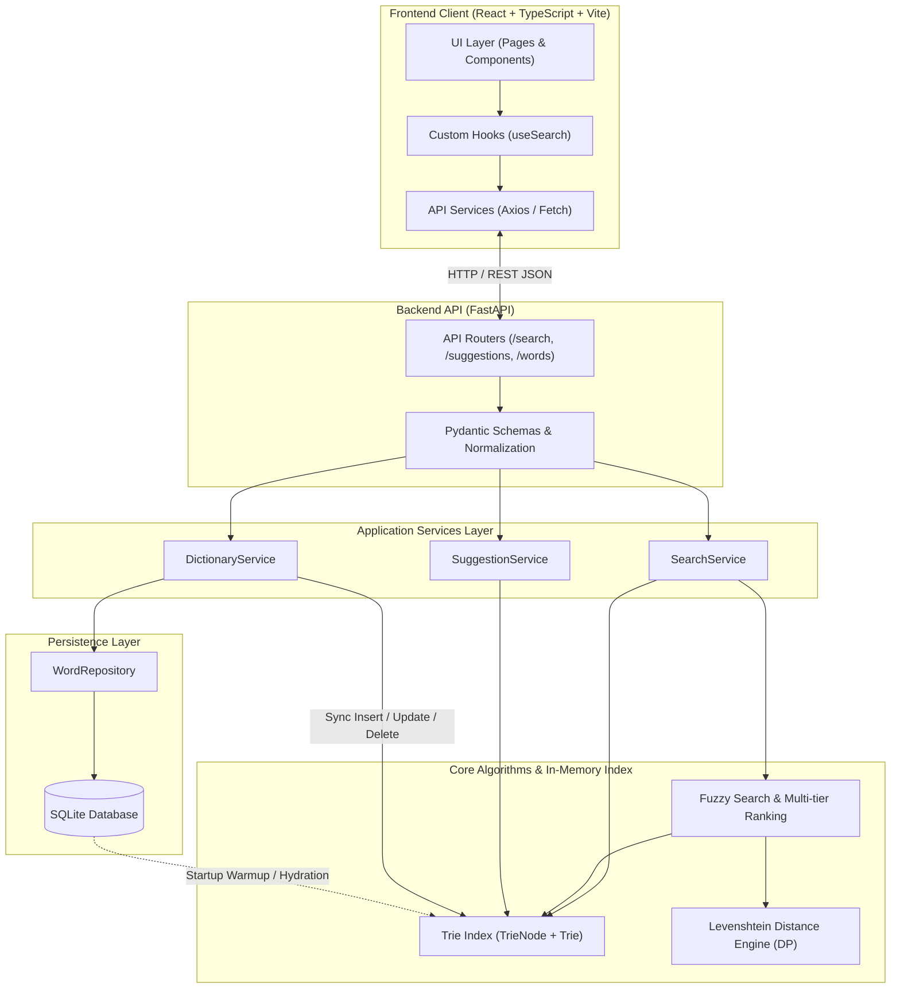

# System Architecture Specification

## 1. High-Level Architectural Pattern
The Smart Dictionary system utilizes a **Layered Architecture** with an in-memory specialized index serving read operations and a relational persistence layer managing transactional state.

---

## 2. In-Memory Index vs. Persistent Storage Synchronization

| Event | Database Action (SQLite) | In-Memory Action (Trie) | Consistency Strategy |
| :--- | :--- | :--- | :--- |
| **Startup / Boot** | Read all headwords (`SELECT id, word FROM words`) | Hydrate Trie via `trie.insert(word, id)` | Cold boot warmup in FastAPI `lifespan` context. |
| **Word Creation** | Insert record into `words` table | `trie.insert(word, new_id)` | Atomic within service: DB commit first, then Trie updated. |
| **Word Update** | Update record in `words` table | If word text changed: `trie.delete(old_word)` then `trie.insert(new_word, id)` | Rollback DB transaction if in-memory sync fails. |
| **Word Deletion** | Delete record from `words` table | `trie.delete(word)` | DB transaction committed, node pruned from Trie. |

---

## 3. Request Lifecycle

1. **Search Query**:
   - Client sends `GET /api/search?q={query}`.
   - Normalization removes surrounding whitespace and converts string to lowercase.
   - Exact Trie lookup: $O(L)$ where $L$ is query length.
   - If exact match exists: fetch word entity from cache/DB and return.
   - If exact match fails: fallback to Fuzzy Search (compute Levenshtein distance against vocabulary, rank by distance, and return "Did you mean?").

2. **Prefix Autocomplete**:
   - Client sends debounced `GET /api/suggestions?q={prefix}&limit=5`.
   - Trie walks down prefix path: $O(P)$.
   - Subtree traversed up to limit $K$: $O(K)$.
   - Returns instantaneous suggestions array.
